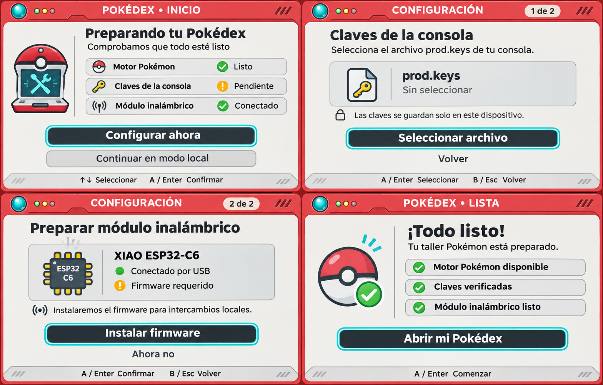
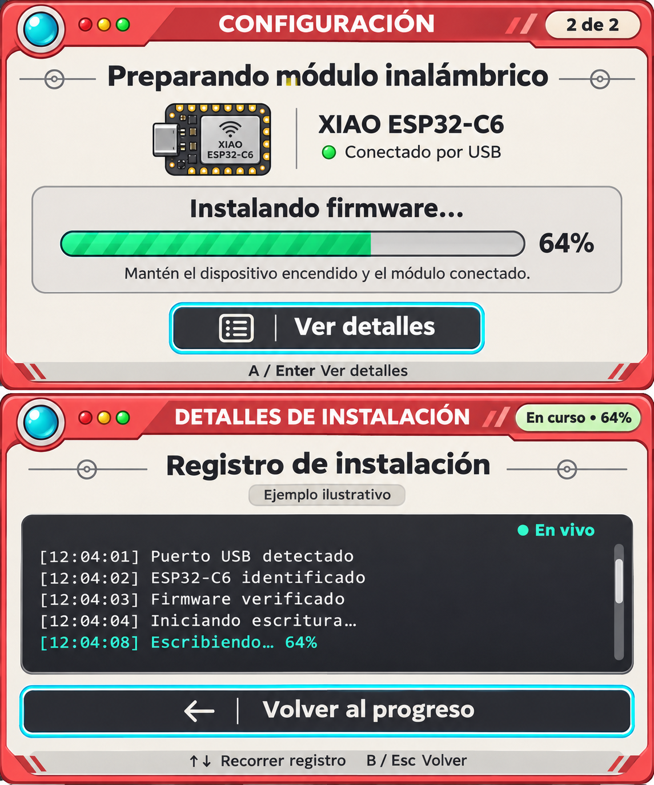

# Referencias visuales aprobadas

Estas imágenes son mockups conceptuales, no capturas de la aplicación ni mediciones de resolución. La implementación debe verificarse con viewport real de 800 × 480.

## Diagnóstico y configuración

## Progreso y registro de instalación

Los porcentajes y mensajes de estas referencias son ilustrativos. En modo real se usan el progreso y los logs del instalador. La demo está identificada y no usa claves ni hardware reales.

## Capturas de la implementación (800 × 480)

- [Diagnóstico real sin placa ni claves configuradas](implemented-health-800x480.jpg).
- [Progreso de la demo, finalizado](implemented-progress-800x480.jpg).
- [Logs de la demo](implemented-logs-800x480.jpg).

Estas capturas corresponden a la primera implementación Flet. La demo simula únicamente el flujo; no prueba una instalación física.

## Intercambios

- [Wireframe interactivo aprobado](portable-trades-wireframe.html).
- [Fuente editable del wireframe](portable-trades-wireframe.fragment.html).
- [Acuerdos completos y alcance de Equipo](../005-portable-trades.md).
- [Captura real de Equipo a 800 × 480](implemented-team-800x480.jpg).
- [Alineación del formulario](implemented-team-aligned-800x480.jpg).
- [Selectores compactos](implemented-team-compact-800x480.jpg).
- [Equipo con opciones filtradas](implemented-team-filtered-800x480.jpg).
- [Búsqueda con desplegable acotado](implemented-dropdown-bounded-800x480.jpg).
- [Identificación y devolución: recibido simulado a 800 × 480](implemented-trainer-return-demo-800x480.jpg). Fixture visual sin radio; no demuestra intercambio físico.

El wireframe simula también modalidades futuras. La captura corresponde al modo Equipo funcional con generación/validación local; no acredita un intercambio físico.

- [Básico con EVs/amistad máximos, fixture a 800 × 480](implemented-basic-max-demo-800x480.jpg).
- [Consulta vacía al recibir foco nativo, fixture 800 × 480](implemented-query-focus-demo-800x480.jpg).

## Modalidades de recepción (fixtures sin radio)

- [Menú de modalidades](implemented-modes-menu-demo-800x480.jpg).
- [Modificador con editor automático](implemented-modifier-demo-800x480.jpg).
- [Configuración de EVs](implemented-effort-mode-demo-800x480.jpg).
- [Validador con tarjeta de estado](implemented-validator-demo-800x480.jpg).
- [Informe completo en modal](implemented-validator-report-demo-800x480.jpg).

Capturas a 800 × 480; los datos son de demostración y no acreditan intercambio físico.

- [Comparación de original y copia](implemented-received-comparison-demo-800x480.jpg): fixture visual DEMO a 800 × 480, cambio exclusivo de nivel; sin intercambio físico.
