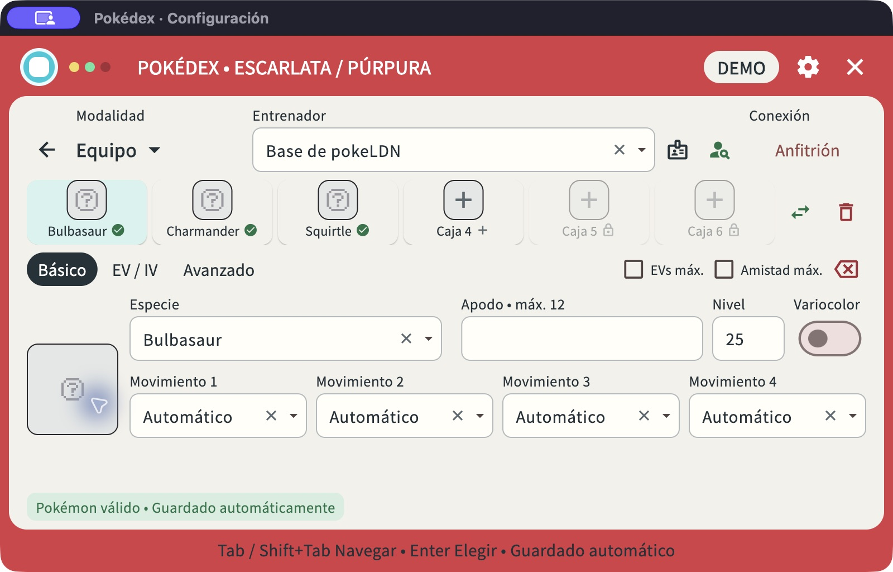
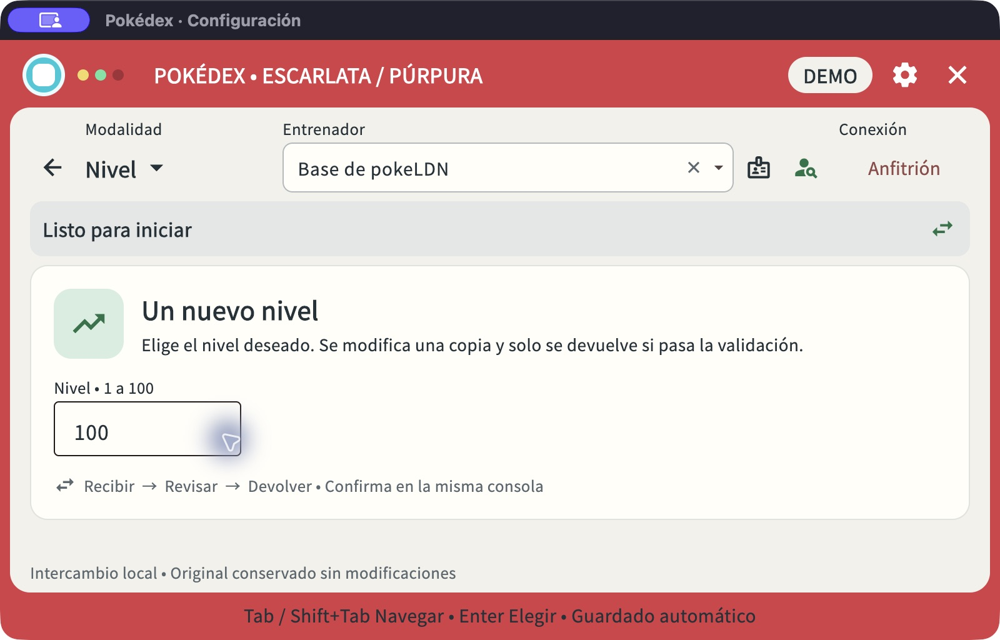
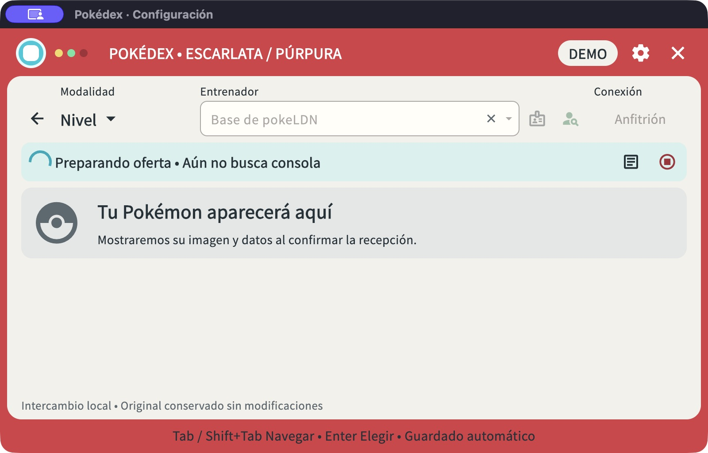
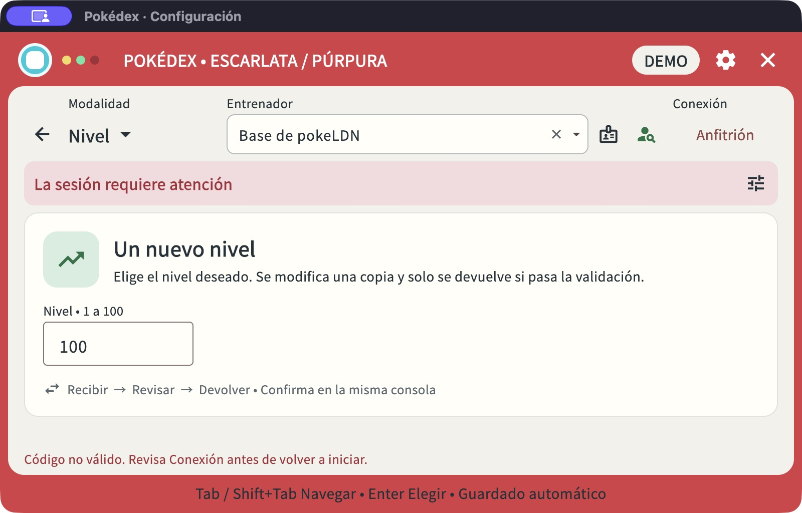

# Auditoría visual portátil — spec 013

Capturas del cliente nativo a 800 × 512 lógicos, incluyendo barra macOS de 32 px: área útil aproximada 800 × 480. Archivos Retina de 1600 × 1024. Todas usan datos DEMO aislados; no hubo radio, intercambios ni instalación de firmware reales. Los signos de interrogación son el fallback sin sprites descargados.

| Captura | Pantalla / estado |
|---|---|
| [01](01-menu.png) | Menú de juegos |
| [02](02-configuracion.png) | Configuración y checks |
| [03](03-claves.png) | Claves simuladas |
| [04](04-modulo.png) | Módulo listo simulado |
| [05](05-equipo-vacio.png) | Equipo vacío, caja 1 disponible |
| [06](06-equipo.png) | Tres Pokémon y caja 4 disponible |
| [07](07-equipo-compactado.png) | Borrado de caja 2: Squirtle se desplaza a la izquierda |
| [08](08-evolucion.png) | Evolución inicial |
| [09](09-nivel.png) | Nivel inicial |
| [10](10-naturaleza.png) | Naturaleza inicial |
| [11](11-esfuerzo.png) | EVs inicial |
| [12](12-modificador.png) | Modificador inicial |
| [13](13-validador.png) | Validador inicial |
| [14](14-preparando.png) | Preparación simulada; todavía no se busca consola |
| [15](15-esperando-consola.png) | Proceso iniciado simulado |
| [16](16-error-inicio.png) | Error simulado de código |
| [17](17-recibido.png) | Resultado legal simulado |
| [18](18-firmware-progreso.png) | Progreso de firmware simulado |
| [19](19-firmware-logs.png) | Logs de firmware simulados |
| [20](20-modificador-recibido.png) | Editor recibido simulado y acciones arriba |
| [21](21-identificar-entrenador.png) | Identificación esperando recepción simulada |
| [22](22-equipo-en-curso.png) | Equipo en curso simulado |
| [23](23-conexion.png) | Diálogo de conexión |

Las recomendaciones y límites están en [spec 013](../../013-portable-ui-polish.md).

## Equipo

## Modalidad de un Pokémon

## Señal de actividad

## Pulido de modales · spec 014

- [Ficha del entrenador](24-modal-entrenador.png)
- [Conexión compacta](25-modal-conexion.png)
- [Conexión Let’s Go](26-modal-conexion-lgpe.png)
- [Error LGPE con acciones accesibles](27-modal-conexion-error.png)

Capturas nativas con perfiles de demostración, sin intercambio físico. Sustituyen la propuesta visual anterior de conexión.

- [Selector directo Anfitrión / Unirse](28-selector-papel.png) (spec 015; revisión nativa sin guardar cambios ni iniciar intercambio).

- [Conexión: alturas y relleno corregidos](29-conexion-alturas-alineadas.png), sustituye visualmente la captura 28.
